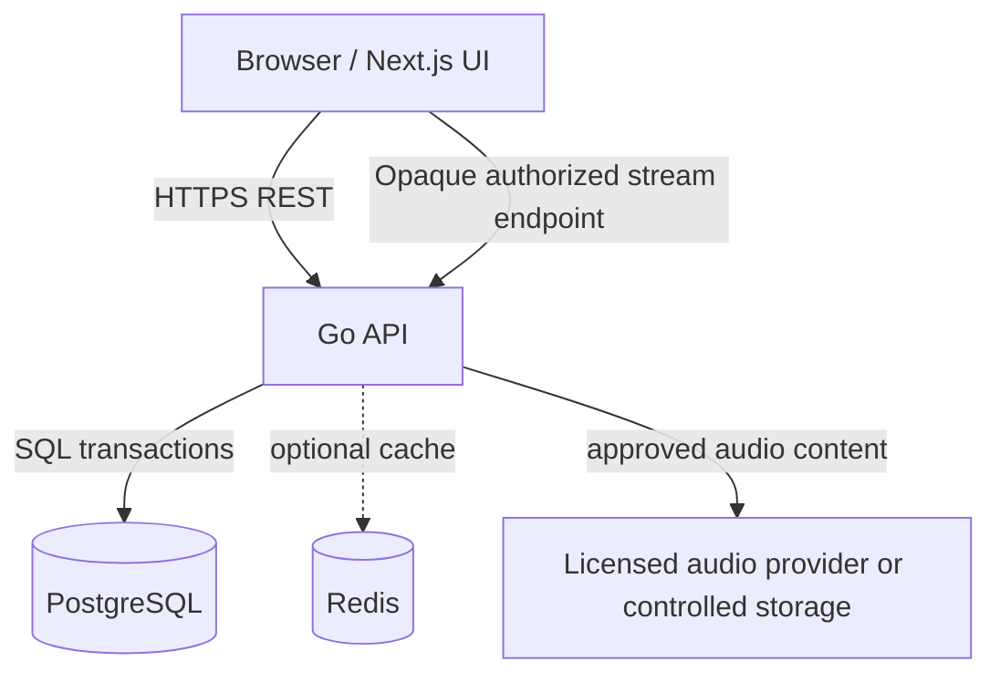

# System architecture — Proposed MVP design

## Logical services


### Responsibilities
**Next.js + TypeScript**: mode select; responsive game screens; accessible autocomplete and audio controls; error/loading/retry states; request idempotency key generation and safe session ID routing. Do not locally compute authoritative correctness or expose answer metadata.

**Go REST API**: guest identity/cookies; song eligibility/randomization; bounded search; game state machine; session authorization; per-guess validation; song/artist answer verification; atomic score updates; anti-abuse/rate limiting; media streaming authorization; status/reveal serialization.

**PostgreSQL**: source of truth for catalog, rights metadata, clips, game sessions, guesses, score; referential integrity and transactional concurrency.

**Redis (later, optional)**: autocomplete cache and/or sorted-set leaderboard if added. Never primary authority for score or game state.

**Audio**: 10 s media preview only from a permitted source, delivered via opaque media endpoint or compatible licensed embed. Rights/provider limitations may constrain the architecture; do not assume clipping arbitrary songs is allowed.

## Trust and data boundaries
- Browser is untrusted: client-provided `mode`, candidate IDs, IDs, request UUIDs and timestamps must be validated.
- Secret target `game_sessions.song_id` must not be included in pre-terminal session serialization.
- For ARTIST, accepted-answer list is server-side only while `PLAYING`.
- Opaque audio token/URL should not encode song titles, artist names or storage keys.
- Autocomplete searches **global active catalog**, not the current target; results do not identify the answer.
- Guest token must not leak into JS, logs, analytics, URLs or repository; account deletion policy not relevant to anonymous MVP but retention is.

## Proposed repository layout
```text
songdle/
├── AGENTS.md
├── README.md
├── docs/
│   ├── 01-PRD.md ... 09-DECISIONS.md
│   └── adr/
├── frontend/
│   ├── src/app/
│   ├── src/components/
│   ├── src/features/game/
│   └── tests/
├── backend/
│   ├── cmd/api/
│   ├── internal/http/
│   ├── internal/game/
│   ├── internal/catalog/
│   ├── internal/storage/
│   └── tests/
├── db/migrations/
├── db/seed/
├── docker-compose.yml
└── .github/workflows/
```
The above is the **target**, not a claim that directories/code already exist.

## Main operations
1. `POST /games`: authorize guest, select playable song/clip, create PLAYING session, return safe response.
2. `GET /songs/search` or `/artists/search`: return paginated limited eligible catalog candidates, independent of current song.
3. `POST /games/{id}/guesses`: verify guest; lock row; check idempotency, terminal state, candidate validity, no duplicate; insert guess; atomically update attempts/status/score; commit; return safe progress or terminal reveal.
4. `GET /games/{id}`: support refresh/resume and terminal results for owning guest only.
5. `GET /games/{id}/audio`: deliver only the selected approved audio without exposing metadata/spoilers; may need an implementation-specific licensed mechanism.

## Operational requirements (to decide during setup)
- Keep secrets in environment variables; checked-in `.env.example` only with placeholders.
- Migrations applied automatically only in dev or via explicit release job in production.
- Structured JSON logs; do not log raw guest tokens, track answers or copyrighted media keys.
- CORS origin allow-list if frontend and API are on separate origins. CSRF defenses for cookie-authenticated mutation requests; `SameSite` alone may be insufficient in all setups.
- HTTP rate limits and request body size limits; enforce bounded search length and result count.
- Health/readiness endpoints, backup strategy and retention to be added before launch.
