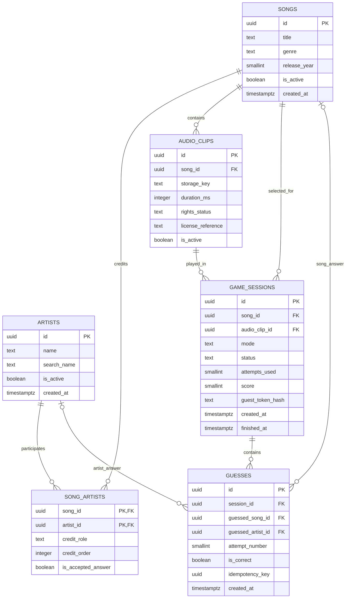

# Database design — PostgreSQL ERD v1.0

**Reference DDL:** `db/reference/001_initial_schema.sql` (designed for PostgreSQL 15+, draft to validate with migrations and integration tests). The reference SQL is not a claim of deployed implementation.

## Logical ERD


## Tables and domain invariants
### `songs`
- `id uuid PK`, `title text NOT NULL`, `genre text NOT NULL`, `release_year smallint NULL`, `is_active bool NOT NULL`, `created_at timestamptz`.
- **Do not** make `title` unique; different songs may share the same title.
- Eligibility for game requires an active track, approved active clip and appropriate credited/accepted artists.

### `artists`
- `id uuid PK`, `name text NOT NULL`, `search_name text NOT NULL`, `is_active bool`, `created_at timestamptz`.
- Display name is not a unique answer key; possible future alias support.

### `song_artists`
- `(song_id, artist_id)` composite PK; `credit_role` (`primary`/`featured`), `credit_order`, `is_accepted_answer` boolean.
- Song-to-artist is many-to-many; accepted answer is per **song-artist relation**, not a global artist property.
- Artist mode game eligibility requires at least one active accepted artist.

### `audio_clips`
- `id`, `song_id`, `storage_key`, `duration_ms = 10000`, `rights_status`, `license_reference`, `is_active`.
- Suggested `rights_status`: `PENDING`, `APPROVED`, `REJECTED`, `EXPIRED`. Only `APPROVED` and active clips can be selected.
- Partial unique index enforces at most one active clip per song.
- `storage_key` is internal; never return directly to the browser as a filename or lookup ID.

### `game_sessions`
- `id`, `song_id`, `audio_clip_id`, `mode ('SONG'|'ARTIST')`, `status ('PLAYING'|'WON'|'LOST')`, `attempts_used 0..5`, `score 0..100`, `guest_token_hash`, timestamps.
- Recommended server invariants: `PLAYING` => score 0 and finished_at null; terminal => finished_at non-null; `LOST` => attempts_used 5 and score 0; `WON` => score by attempt number. Database CHECK can enforce most simple conditions.
- `song_id` is secret until finish. `audio_clip_id` references a clip of *the same song*. Reference SQL uses composite FK `(audio_clip_id, song_id)` to preserve alignment.

### `guesses`
- `id`, `session_id`, one and only one candidate (`guessed_song_id` XOR `guessed_artist_id`), `attempt_number 1..5`, `is_correct`, `idempotency_key`, timestamps.
- Unique `(session_id, attempt_number)` prevents two guesses in one slot.
- Unique `(session_id, idempotency_key)` handles retried submissions.
- Unique `(session_id, guessed_song_id)` and `(session_id, guessed_artist_id)` independently prevent duplicate candidate guessing. PostgreSQL permits multiple NULL values, so these indexes work alongside the XOR CHECK.
- Backend validates candidate type against session mode; cross-table validation cannot be a simple per-row CHECK.

## Recommended indexes
- `artists(search_name)` for lookup; consider `pg_trgm` after benchmarking multilingual search / data normalization.
- `songs(title)` for lookup; consider normalized search column or carefully tuned ILIKE/trigram strategy.
- `song_artists(song_id, is_accepted_answer)` and reverse `(artist_id, song_id)`.
- `game_sessions(guest_token_hash, created_at DESC)` for guest resume.
- `game_sessions(status, created_at)` for expiry cleanup.
- Unique indexes for guesses, plus `guesses(session_id, created_at)`.

## Transaction pseudocode — submit guess
```text
BEGIN;
  SELECT * FROM game_sessions WHERE id=? FOR UPDATE;
  assert same guest token hash; -- do not disclose other guest's session
  if idempotency key previously exists:
      verify same payload; return original persisted outcome;
  reject if status != PLAYING;
  validate candidate exists, active, and of correct type;
  reject if candidate already guessed in this round;
  next_n = attempts_used + 1;
  correct = (mode=SONG AND candidate_song_id=song_id)
         OR (mode=ARTIST AND accepted song_artists row exists);
  INSERT guesses(..., attempt_number=next_n, is_correct=correct, idempotency_key=?);
  UPDATE game_sessions SET attempts_used=next_n,
    status=(correct ? WON : next_n==5 ? LOST : PLAYING),
    score=(correct ? 120-20*next_n : 0),
    finished_at=(correct OR next_n==5 ? now() : NULL);
COMMIT;
```
The API should re-read/return the authoritative response after commit. For exact idempotent response replay under intermediate states, persist response snapshot or reconstruct carefully from the original guess; ensure consistent terminal reveal semantics.

## Important design notes / migrations
1. Verify PostgreSQL DDL in isolated database (do not treat reference SQL as production migration without testing).
2. Keep song/artist display data **not returned** in active-game API; autocomplete is a separate global catalog query.
3. Do not rely solely on CHECK for state transitions; transactional service-layer tests still required.
4. Add data retention and guest expiry/purge plan before deployment.
5. Keep license evidence and source provenance external or linked via permission metadata; avoid public storage links in API responses.
