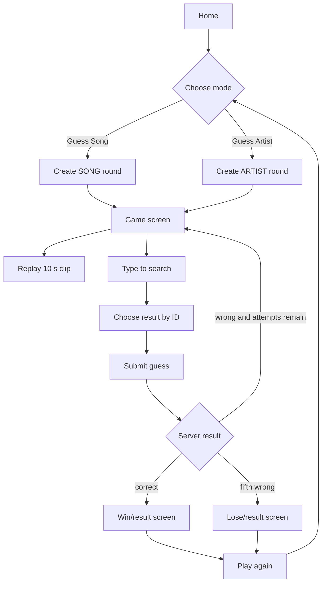

# UX / User flow specification

## Main user journey

## Screen inventory
| Screen | Contents / components | Required states |
|---|---|---|
| Home | App name, 2 mode choices, Start CTA | ready / start loading / start error |
| Game | mode label, audio play/replay, progress 0..5, search combobox, selected candidate, submit | audio loading/playing/error, search loading/empty/error, submit loading/error, recovery |
| Result | WON/LOST, points, correct song and artist credits, past guesses, Play Again | loaded / new game pending/error |
| Global shell | Responsive layout, accessible navigation, privacy/media rights note | mobile and desktop |

## Autocomplete behavior
- Search by text; results are bounded (proposal max 20) and come from active catalog.
- Keyboard: Tab focuses combobox, ArrowUp/ArrowDown navigates suggestions, Enter selects, Escape dismisses; visibly focused item.
- Screen reader: label + combobox roles, count/selection announced, errors announced.
- Selected item must be explicit; free text alone cannot be submitted.
- On query change after selection, clear candidate ID or require reselection; do not let stale ID silently submit.
- Debounce remote query; cancel out-of-date requests; handle IME composition appropriately for Thai input.
- Prevent new selection of already guessed candidates (server still validates).

## Active round visual information
Show status, mode, attempts used/remaining, 10 s audio control, selected option, prior guesses and whether each was wrong. Never show target title, artists, song ID or spoiler-bearing filenames while PLAYING.

## Error copy and recovery
- Audio fails: "ไม่สามารถเล่นเสียงได้ ลองอีกครั้งหรือเริ่มเกมใหม่" (do not spend an attempt).
- No results: "ไม่พบรายการที่ตรงกับคำค้น".
- Duplicate: "เคยตอบตัวเลือกนี้แล้ว ลองเลือกคำตอบอื่น".
- Validation mismatch: "โปรดเลือกคำตอบจากรายการ".
- API timeout: "การเชื่อมต่อมีปัญหา กำลังตรวจสอบสถานะเกม"; recover with same request_id or fetch game.
- Session unavailable: "ไม่พบรอบเกมนี้หรือสิทธิ์เข้าถึงหมดอายุ"; offer Start Game.

## Mobile-first constraints
- Audio controls and submit targets should be large enough for comfortable tapping.
- Suggestions should not be hidden under mobile keyboards or offscreen overlays.
- Use persistent selected answer, visible remaining guesses and high-contrast success/error feedback.
- No color-only indication of correctness; include labels/icon/text.

## Suggested route layout (proposal)
- `/` mode selection and home.
- `/game/[id]` play/resume.
- Same `/game/[id]` page can show result state after terminal; separate `/result/[id]` route optional.

## UX acceptance checklist
- [ ] Keyboard-only player completes both modes.
- [ ] Screen reader can identify list suggestions and result feedback.
- [ ] Mobile 360px-wide device can start, play, search, submit and see result without clipped UI.
- [ ] Session refresh restores correct attempt count without leaking correct answer.
- [ ] Audio failure offers recovery rather than incorrectly decrementing guesses.
